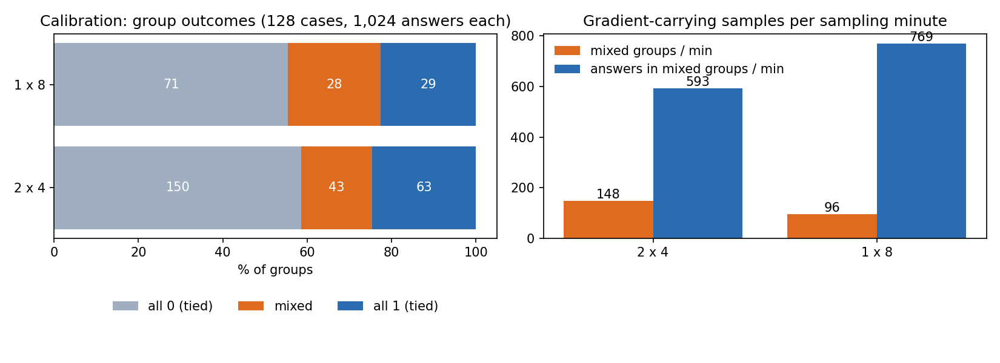
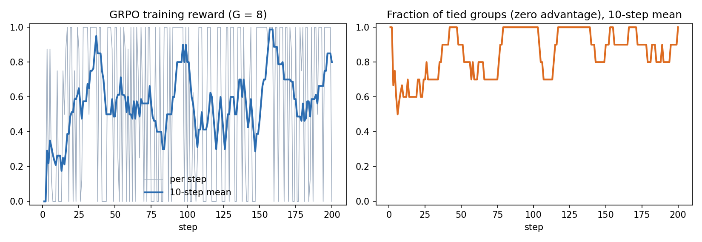
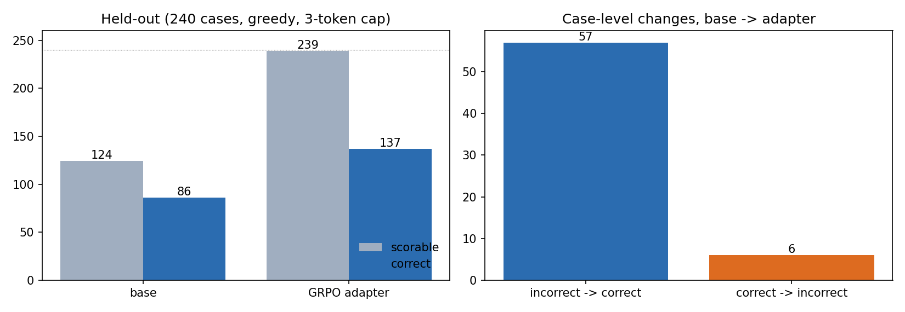

# GRPO Lab — Reward Design with CoD

**Model:** `Qwen/Qwen3-1.7B` at revision `70d244cc86ccca08cf5af4e1e306ecf908b1ad5e` (non-thinking mode), Unsloth 4-bit LoRA, TRL GRPO.
**Hardware:** a single Tesla T4 (Google Colab). **Seed:** 3407. Every number below comes from `results/*.json`, produced by `grpo_lab.py`.

| | Result |
|---|---|
| Verifier tests | 23 / 23 pass |
| Chosen group size | **G = 8** (769 vs 593 gradient-carrying answers per sampling minute) |
| Training | 200 steps, **4.0 min** wall time including rollouts, **2.12 GB** peak allocated VRAM |
| Held-out (240) | base **86** correct / 124 scorable → adapter **137** correct / 239 scorable |
| Case flips | **57** incorrect→correct, **6** correct→incorrect |
| Main finding | 86% of training steps had tied rewards and no gradient. All 57 gains were format fixes; on the cases both models answered, accuracy fell from 86 to 80. |

---

## 1. Reward verifier (`verifier.py`)

`extract_choice(text)` returns a choice only when all of the following hold:
1. The reply **starts** with one uppercase `A`, `B` or `C`. It may be preceded by `Answer:`, `(`, `[`, `**` or whitespace, and the letter must not continue into a word (so `Answer`, `AB` and `A`lveolar do not count).
2. The reply contains **no other** standalone choice letter (so `A or B`, `B/C` and `A (not B` are rejected as ambiguous).

`reward(completion, ref)` returns 1.0 if the extracted letter equals the reference letter. Otherwise it returns 0.0, and that includes every invalid reply. Lowercase letters are rejected on purpose, so the article "a" can never count as a choice. Evaluation uses the same function, so an invalid reply always counts as incorrect.

**Test evidence** (`python test_verifier.py`, saved in `results/verifier_tests.txt`): **23/23 pass**.

| category | examples | expected |
|---|---|---|
| correct (8) | `A`, `B.`, `(C)`, `**A**`, `Answer: B`, `" C\n"`, `A. Pneum`, `<think></think>B` | parsed letter, reward 1 |
| incorrect (3) | `B` (ref A), `C.` (ref A), `Answer: A` (ref C) | parsed letter, reward 0 |
| malformed (8) | `""`, `The patient`, `D`, `a`, `Answer`, `Pneumonia`, `AB`, `None` | invalid, reward 0 |
| ambiguous (4) | `A or B`, `A, C`, `B/C`, `A (not B` | invalid, reward 0 |

## 2. Rollout calibration

**Setup.** This used the pretrained model, the same 128 calibration cases (from `calibration-case-ids.json`) and the same prompt, with temperature 1.0, top_p 1.0, top_k off and `max_new_tokens=3`, in both settings.
- Setting "4": two independent groups of 4 per case, giving 256 groups.
- Setting "8": one group of 8 per case, giving 128 groups.

Each setting produced **1,024 answers**. Both settings sent 64 sequences per `generate` call, and each had one untimed warm-up call. Timing used `torch.cuda.synchronize()` and `perf_counter`.

| setting | groups | answers | scorable | scorable rate | correct | mixed groups | mixed % | all-1 | all-0 | sampling time | mixed groups / min | answers in mixed groups / min |
|---|---|---|---|---|---|---|---|---|---|---|---|---|
| 2 × 4 | 256 | 1024 | 549 | 53.6% | 342 | **43** | **16.8%** | 63 | 150 | 17.4 s | **148.2** | 593 |
| 1 × 8 | 128 | 1024 | 558 | 54.5% | 351 | **28** | **21.9%** | 29 | 71 | 17.5 s | **96.2** | **769** |



**Choice: G = 8.**
- The two settings cost the same sampling time (17.4 s vs 17.5 s for 1,024 three-token answers), so they can be compared minute for minute.
- G = 4 produces more mixed *groups* per minute (148 vs 96), but each mixed group of 4 gives only 4 answers with non-zero advantage.
- G = 8 produces **769 vs 593 gradient-carrying answers per minute (+30%)** and a higher mixed rate (21.9% vs 16.8%). That is expected: for a per-answer success rate p, P(mixed) = 1 − pᴳ − (1−p)ᴳ grows with G.
- Each setting found mixed groups on 28 distinct cases out of 128 (22 cases are mixed in both settings). G = 8 also gives a less noisy baseline (the group mean) for each advantage.

**Why the scorable rate is only about 54%.** Most invalid answers were prose openers cut off by the 3-token cap. `"The most likely"` appeared 247 times in the first calibration pass, and in the G = 8 setting 65% of answers in all-zero groups were invalid. The verifier is behaving as specified: with a 3-token budget, a reply that doesn't start with the letter cannot be scored.

> Provenance note: the first calibration pass loaded Unsloth's pre-quantized mirror (`unsloth/Qwen3-1.7B-unsloth-bnb-4bit`) and silently ignored the pinned revision. Those results are kept as `results/*unsloth_repo_discarded*` and are **not** used. Every number in this report comes from the exact `Qwen/Qwen3-1.7B` at the pinned revision (`use_exact_model_name=True`).

## 3. GRPO training (one run, 200 steps)

| item | value |
|---|---|
| Hardware | 1 × Tesla T4 (14.56 GB usable), CUDA 13.0, Python 3.13.16, Google Colab |
| Model / revision | `Qwen/Qwen3-1.7B` @ `70d244cc86ccca08cf5af4e1e306ecf908b1ad5e`, loaded in 4-bit (bitsandbytes), fp16 compute (T4 has no bf16) |
| Packages | unsloth 2026.11.12, unsloth_zoo 2026.11.12, torch 2.14.1+cu130, transformers 5.17.0, trl 1.15.0, peft 0.21.2, bitsandbytes 0.50.2, accelerate 1.15.0, datasets 4.8.5 (full list in `results/pip_freeze.txt`) |
| Seed | 3407 (`seed`, `data_seed`, LoRA `random_state`) |
| LoRA | r = 16, alpha = 16, dropout 0, targets q/k/v/o/gate/up/down projections |
| GRPO | G = 8, 8 completions per step (1 prompt per step), 200 steps, lr 1e-5 cosine, adamw_8bit, max_grad_norm 0.1, beta = 0 (no KL), loss_type `grpo`, temperature 1.0, top_p 1.0, top_k off, `max_completion_length = 3` |
| Not applied | `warmup_ratio` and `max_prompt_length` aren't fields in TRL 1.15, so they were recorded and dropped (prompts are short, well under 1k tokens) |
| **Training wall time** | **241.4 s (4.0 min)**, measured around `trainer.train()`, so it includes rollout generation |
| **Peak allocated VRAM** | **2.12 GB** (`torch.cuda.max_memory_allocated`) |

**Case selection.** The dataset was the full 480-case training pool, including the 128 calibration cases. TRL's seeded sampler (`data_seed = 3407`) drew one prompt per step, so 200 steps used **200 unique cases**, 59 of which were also calibration cases. Every drawn case, its 8 completions and their rewards are logged in `results/train_rollouts.jsonl`.



**What the 200 steps contained:**

| group outcome | steps |
|---|---|
| all 1 (tied) | 99 |
| all 0 (tied) | 73 |
| mixed | **28** |

So 86% of steps had zero reward variance (`frac_reward_zero_std` averaged 0.86). The logged `grad_norm` on **every** tied step is exactly 0.0. Of the 28 mixed steps, 4 (steps 3, 5, 6 and 172) had non-finite gradient norms under fp16, and the optimizer skips such updates. That leaves **24 effective updates in 200 steps**. Their gradient norms of 14–89 were clipped to 0.1.

Over training, the sampled answers moved from prose to letters. In steps 1–100, `"The most likely"` appeared 57 times among the sampled completions. In steps 101–200 it fell out of the top completions, which were bare letters (`A` 244, `C` 223, `B` 149). Mean reward rose from 0.555 to 0.601.

## 4. Held-out evaluation (240 cases)

Both models received identical prompts with greedy decoding, `max_new_tokens = 3`, left padding, the same batching (32 per batch) and the same verifier. The base model is the *same loaded 4-bit weights* with the adapter disabled (`model.disable_adapter()`).

| model | scorable | correct |
|---|---|---|
| base Qwen3-1.7B | **124 / 240** | **86 / 240** (35.8%) |
| GRPO adapter | **239 / 240** | **137 / 240** (57.1%) |

**Incorrect → correct: 57. Correct → incorrect: 6.** The adapter's raw answer differed from the base model's on 228 cases.



**Where the change came from** (base → adapter, per case):

| base \ adapter | correct | wrong letter | invalid |
|---|---|---|---|
| **correct** | 80 | 6 | 0 |
| **wrong letter** | 0 | 38 | 0 |
| **invalid** | 57 | 58 | 1 |

- **All 57 improvements were invalid → correct.** The base model started its reply with prose (`"The most likely"` on 103 of 240 cases), which used up the 3-token budget. The adapter answers with the letter first.
- **Zero cases went from wrong letter to correct.** On the 124 cases both models answered, the base model got **86** right and the adapter **80**, and all 6 regressions were correct → wrong letter.
- The adapter also leans toward `C`: it predicted C 101 times, against 82 C answers in the gold labels.

## 5. Interpretation

**Why tied rewards give zero relative reward signal.** GRPO has no value network. Each answer's advantage is its reward compared with the other answers in its group:

Âᵢ = (rᵢ − mean(r₁…r_G)) / (std(r₁…r_G) + ε)

If all G answers earn the same reward (all 0 or all 1), every rᵢ equals the mean, so every Âᵢ = 0. The policy-gradient term Σ Âᵢ ∇log π(oᵢ) then vanishes. With beta = 0 there is no KL term either, so the step produces no update at all. The training log shows this directly: `grad_norm = 0.0` on every step with `frac_reward_zero_std = 1`. A tied group doesn't say "this answer is good" or "this answer is bad"; it says nothing, because GRPO only learns from *differences inside a group*.

**How reward variation relates to held-out accuracy here.**
- Calibration already predicted that most compute would be wasted. Even at G = 8, 78% of groups were tied, and 55% were all-0, mostly prose replies cut off by the cap.
- Training matched that: only 28 of 200 steps were mixed, and only 24 of those produced an update.
- The variation that did exist was mostly *format* variation. In a typical mixed group, some samples started with the letter and some with "The most likely". The relative signal therefore rewarded "answer with the letter first", and that is exactly what transferred to held-out: scorable answers rose from 124 to 239.
- The training signal did *not* contain much medical discrimination. In the mixed groups, 68 of the 91 zero-reward answers were wrong letters, so some content signal was present. But 24 small, clipped updates on 24 cases were not enough to improve diagnosis. On the cases both models answered, accuracy went *down* from 86 to 80, with a drift toward option C.

**Case examples:**
- *Format fix (incorrect → correct), `en_8793_5`.* Findings: muscle atrophy, slow growth, joint pain, local swelling, reduced mobility of the nearby joint, slight fever, weight loss. Options: A Localized Scleroderma / B Pleomorphic Lipoma / **C Adamantinoma of the Long Bones** (reference C).
  - The base model replied `"The most likely"`, which is invalid under the 3-token cap and scores 0.
  - The adapter replied `"C"`, which scores 1.
  - The model may already have "known" the answer; GRPO taught it to *say* the letter within budget. This is the kind of case where a group of 8 samples is mixed (some letter-first, some prose), so it gets a non-zero advantage.
- *Regression (correct → incorrect), `en_12012_2`.* Findings: dysarthria, child, hearing loss, difficulty swallowing, muscle stiffness. Options: **A Pediatric Hereditary Ataxia** / B Spinocerebellar Degeneration / C Bulbar Paralysis (reference A).
  - The base model replied `"A. Pediatric"`, which is correct.
  - The adapter replied `"C"`, which is wrong.
  - Five of the six regressions follow this pattern (a correct A becomes C), consistent with the C drift. A few noisy, clipped updates moved the letter prior rather than clinical reasoning.

**Limitation.** The headline accuracy gain (+51 cases) mostly measures **format compliance under a 3-token cap**, not diagnostic ability. Several factors limit what the run can show about diagnosis:
- Most steps gave no signal (86% tied).
- Only 24 updates happened, on 24 cases.
- It is one seed.
- The verifier rejects truncated replies like `"B. C…"`, whose second letter is really the start of an option name.

On the 124 commonly scorable cases, the 6 regressions vs 0 gains is suggestive but small (an exact McNemar test gives p ≈ 0.03), so the "content got worse" result also needs replication.

**Follow-up that would test it.** Separate format from content and increase the number of informative groups:
1. **Format-neutral evaluation:** re-score both models with a longer cap (for example 32 tokens) using the same verifier. Alternatively, compare letter log-probabilities directly after a fixed `"Answer:"` prefix. If the gain disappears, it was format only.
2. **Difficulty-filtered GRPO with seeds:** train on cases that were *mixed* in a calibration pass (non-zero reward variance), across 3–5 seeds, and report the McNemar test on held-out flips among cases both models answered.

If tied groups are the bottleneck, the filtered run should show a much lower `frac_reward_zero_std`, more effective updates and an improvement on wrong-letter → correct cases, which this run never achieved.

## Reproduce

See `README.md`. In short, on a single 16 GB GPU with the course data unzipped into `data/`:

```bash
pip install unsloth
python test_verifier.py
python grpo_lab.py calib --data data
python grpo_lab.py train --data data      # picks G from calibration (8)
python grpo_lab.py eval  --data data
python grpo_lab.py report && python make_figures.py
```

Small run-to-run differences are possible on other GPUs and library versions. The exact versions and per-step logs are in `results/`.
